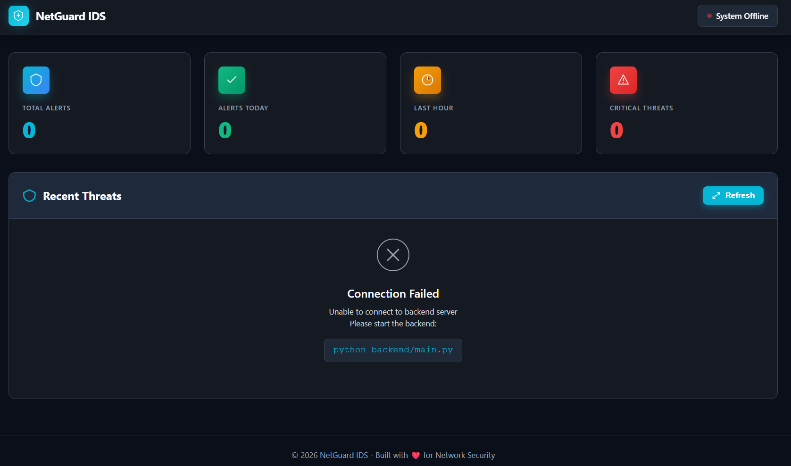
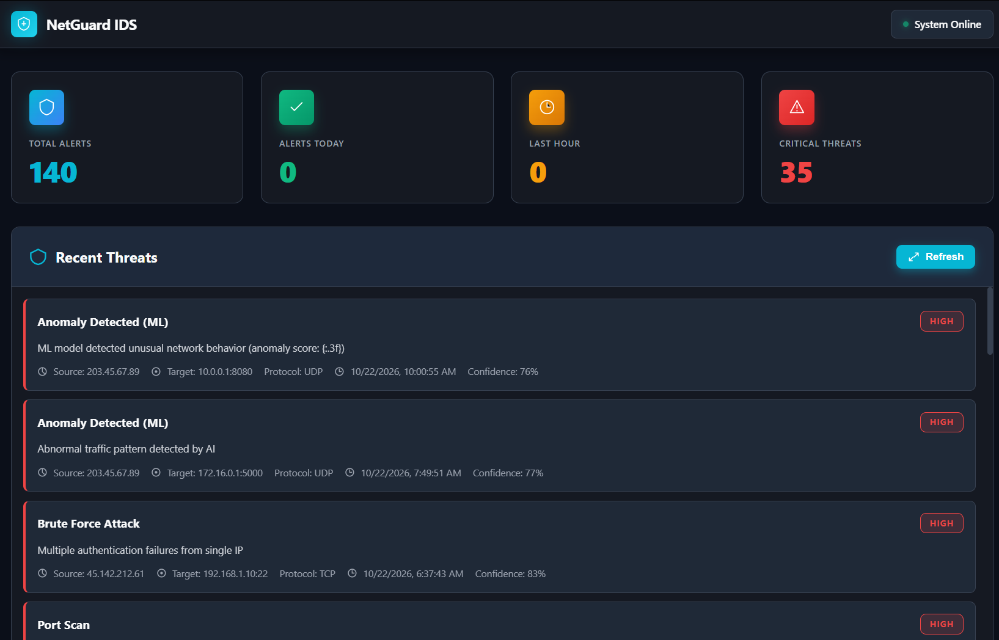

# 🛡️ NetGuard IDS - Network Intrusion Detection System

<div align="center">


**A professional, real-time Network Intrusion Detection System with ML-powered threat detection and a beautiful SOC dashboard.**

[Features](#-features) • [Demo](#-demo-screenshots) • [Installation](#-installation) • [Usage](#-usage) • [Architecture](#️-architecture)

</div>

---

## 📸 Demo Screenshots

### Dashboard - Before Starting Detection
*Screenshot showing the clean, professional dashboard interface*



### Dashboard - Active Threat Detection
*Screenshot showing real-time threat detection with 140+ alerts, color-coded severity levels, and live statistics*



---

## ✨ Features

### 🔍 **Real-Time Network Monitoring**
- Live packet capture using Scapy
- Multi-protocol support (TCP, UDP, ICMP, DNS)
- Auto-detection of network interfaces
- Continuous traffic analysis

### 🤖 **Intelligent Threat Detection**
- **Signature-Based Detection:**
  - 🚨 Port Scan Detection (50+ ports threshold)
  - 💥 DDoS Attack Recognition (1000+ packets/10s)
  - 💉 SQL Injection Pattern Matching
  - 🔑 Brute Force Attack Detection
  - ⚠️ Suspicious Port Access Monitoring

- **ML-Based Anomaly Detection:**
  - Isolation Forest algorithm
  - NSL-KDD dataset training
  - Behavioral anomaly detection
  - Zero-day threat identification

### 📊 **Professional SOC Dashboard**
- Beautiful, modern UI with professional design
- Real-time statistics and metrics
- Color-coded severity levels (Critical, High, Medium, Low)
- Auto-refresh every 5 seconds
- Detailed alert information with source/destination IPs
- Responsive design for all devices

### 🗄️ **Data Management**
- SQLite database with SQLAlchemy ORM
- Persistent alert storage
- Traffic logging and forensics
- Alert history and timeline
- Database viewer utility

### ⚡ **Easy Deployment**
- One-click startup with `START_NETGUARD.bat`
- Test data generator for demos
- API-only mode (no packet capture required)
- Admin privilege checker
- Cross-platform support (Windows/Linux/macOS)

---

## 🏗️ Architecture

```
┌──────────────────────────────────────────┐
│         Frontend Dashboard               │
│    (Vanilla JS, HTML5, CSS3)            │
│    http://localhost:3000                 │
└──────────────┬───────────────────────────┘
               │ REST API Calls
               │ (Every 5 seconds)
               ▼
┌──────────────────────────────────────────┐
│         FastAPI Backend                  │
│         http://localhost:8000            │
├──────────────────────────────────────────┤
│  API Endpoints:                          │
│  • GET  /api/alerts                      │
│  • GET  /api/stats                       │
│  • GET  /api/alerts/by-type              │
│  • GET  /api/alerts/timeline             │
│  • GET  /api/health                      │
└──────────────┬───────────────────────────┘
               │
               ▼
┌──────────────────────────────────────────┐
│        Detection Engine                  │
├──────────────────────────────────────────┤
│  1. Packet Capture (Scapy)              │
│     └─ Network Interface Sniffer         │
│                                          │
│  2. Signature Detection                  │
│     ├─ Port Scan Detector                │
│     ├─ DDoS Pattern Analyzer             │
│     ├─ SQL Injection Scanner             │
│     └─ Brute Force Monitor               │
│                                          │
│  3. ML Anomaly Detection                 │
│     └─ Isolation Forest Model            │
└──────────────┬───────────────────────────┘
               │
               ▼
┌──────────────────────────────────────────┐
│       SQLite Database                    │
│       (SQLAlchemy ORM)                   │
├──────────────────────────────────────────┤
│  Tables:                                 │
│  • alerts         (threat data)          │
│  • traffic_logs   (packet metadata)      │
└──────────────────────────────────────────┘
```

---

## 🚀 Installation

### Prerequisites

- **Python 3.8+** (Tested on Python 3.14)
- **Npcap** (Windows) or libpcap (Linux/macOS) - for packet capture
- **Administrator/Root privileges** - required for network sniffing
- **Git** - for cloning the repository

### Step 1: Clone the Repository

```bash
git clone https://github.com/YOUR_USERNAME/netguard-ids.git
cd netguard-ids
```

### Step 2: Install Python Dependencies

```bash
cd backend
pip install -r requirements.txt
```

**Required packages:**
- fastapi
- uvicorn[standard]
- scapy
- sqlalchemy
- python-dotenv
- pydantic
- websockets
- python-socketio
- httpx
- colorlog
- aiofiles

### Step 3: Install Npcap (Windows Only)

Download and install Npcap from: https://npcap.com/

**Important:** Enable "WinPcap API-compatible Mode" during installation

### Step 4: Initialize Database

The database will be created automatically on first run.

---

## 🎮 Usage

### Option 1: One-Click Startup (Windows)

**Double-click:** `START_NETGUARD.bat`

This will:
1. ✅ Check for admin privileges
2. ✅ Start the backend API server
3. ✅ Start the frontend dashboard
4. ✅ Auto-open Chrome browser

### Option 2: Manual Startup

**Terminal 1 - Start Backend:**
```bash
cd backend
python run_api.py
```
Backend runs on: `http://localhost:8000`

**Terminal 2 - Start Frontend:**
```bash
cd frontend
python server.py
```
Dashboard opens at: `http://localhost:3000`

### Option 3: Real Packet Capture Mode

**Requires:** Administrator privileges + Npcap installed

```bash
cd backend
python main.py  # Captures real network traffic
```

---

## 🧪 Testing with Demo Data

Want to see the dashboard in action without real traffic?

```bash
cd backend
python generate_test_alerts.py
```

This creates 20 realistic test alerts:
- Port scans
- DDoS attacks
- SQL injections
- Brute force attempts
- Anomaly detections

**View Database:**
```bash
cd backend
python view_database.py --stats
```

---

## 📊 Detection Thresholds

Configure detection sensitivity in `backend/config.py`:

```python
# Signature Detection Thresholds
PORT_SCAN_THRESHOLD = 50        # Ports scanned in 60s
DDOS_THRESHOLD = 1000           # Packets in 10s
BRUTE_FORCE_THRESHOLD = 5       # Failed attempts in 60s

# ML Detection Sensitivity
ANOMALY_CONTAMINATION = 0.1     # Expected % of anomalies
```

---

## 🛠️ Tech Stack

### Backend
- **FastAPI** - High-performance async API framework
- **Scapy** - Packet manipulation and capture
- **SQLAlchemy** - Database ORM
- **Uvicorn** - ASGI server
- **Pydantic** - Data validation

### Frontend
- **Vanilla JavaScript** - No frameworks, pure performance
- **HTML5 & CSS3** - Modern web standards
- **Fetch API** - RESTful API communication
- **Python HTTP Server** - Simple static file serving

### Machine Learning
- **Scikit-learn** - Isolation Forest algorithm (optional)
- **NSL-KDD Dataset** - Network intrusion dataset

### Database
- **SQLite** - Lightweight, serverless database
- **SQLAlchemy** - Python SQL toolkit

---

## 📁 Project Structure

```
netguard-ids/
├── backend/
│   ├── main.py                 # Main IDS with packet capture
│   ├── run_api.py              # API-only mode
│   ├── config.py               # Configuration settings
│   ├── requirements.txt        # Python dependencies
│   │
│   ├── capture/
│   │   ├── sniffer.py          # Packet capture engine
│   │   └── parser.py           # Packet parser
│   │
│   ├── detection/
│   │   ├── signature_rules.py  # Signature-based detection
│   │   └── ml_detector.py      # ML anomaly detection
│   │
│   ├── api/
│   │   └── app.py              # FastAPI application
│   │
│   ├── database/
│   │   ├── models.py           # SQLAlchemy models
│   │   └── db.py               # Database operations
│   │
│   ├── generate_test_alerts.py # Test data generator
│   └── view_database.py        # Database viewer
│
├── frontend/
│   ├── index.html              # Main dashboard page
│   ├── server.py               # HTTP server
│   │
│   └── assets/
│       ├── css/
│       │   └── styles.css      # Professional SOC theme
│       └── js/
│           └── app.js          # Dashboard logic
│
├── START_NETGUARD.bat          # One-click startup (Windows)
├── GENERATE_TEST_ALERTS.bat    # Quick test data
├── README.md                   # This file
├── PROJECT_GUIDE.md            # Detailed documentation
└── QUICKSTART.md               # 5-minute setup guide
```

---

## 🎯 API Endpoints

### Base URL: `http://localhost:8000`

| Endpoint | Method | Description |
|----------|--------|-------------|
| `/api/health` | GET | Health check |
| `/api/alerts` | GET | Get recent alerts (limit=100) |
| `/api/stats` | GET | Get system statistics |
| `/api/alerts/by-type` | GET | Alerts grouped by type |
| `/api/alerts/timeline` | GET | Alert timeline data |

### Example Response: `/api/stats`

```json
{
  "total_alerts": 140,
  "alerts_today": 76,
  "alerts_last_hour": 5,
  "critical_alerts": 31,
  "high_alerts": 42,
  "medium_alerts": 38,
  "low_alerts": 29,
  "alerts_by_type": {
    "Port Scan": 35,
    "SQL Injection": 28,
    "DDoS Attack": 25,
    "Brute Force Attack": 22,
    "Suspicious Port Access": 18,
    "Anomaly Detected (ML)": 12
  }
}
```

---

## 🔧 Configuration

### Backend Configuration (`backend/config.py`)

```python
# API Settings
API_HOST = "0.0.0.0"
API_PORT = 8000

# Detection Thresholds
PORT_SCAN_THRESHOLD = 50
DDOS_THRESHOLD = 1000
BRUTE_FORCE_THRESHOLD = 5

# Database
DATABASE_URL = "sqlite:///netguard.db"

# Packet Capture
CAPTURE_INTERFACE = "auto"  # Auto-detect or specify interface
CAPTURE_FILTER = "tcp or udp"
```

---

## 🐛 Troubleshooting

### Issue: "Sniffing not available at layer 2"
**Solution:** Install Npcap (Windows) with WinPcap compatibility mode

### Issue: "Permission denied" when starting
**Solution:** Run as Administrator (Windows) or with `sudo` (Linux/macOS)

### Issue: Dashboard shows 0 alerts
**Solution:** 
1. Make sure backend is running: `python run_api.py`
2. Generate test data: `python generate_test_alerts.py`
3. Hard refresh browser: `Ctrl + Shift + R`

### Issue: Python package installation fails
**Solution:** Use Python 3.8-3.12 (3.14 has limited package support)

---

## 📈 Future Enhancements

- [ ] Real-time WebSocket updates
- [ ] Network topology visualization
- [ ] Export alerts to CSV/JSON
- [ ] Email/Slack notifications
- [ ] Custom detection rules editor
- [ ] Deep packet inspection
- [ ] GeoIP mapping for source IPs
- [ ] Integration with SIEM systems
- [ ] Docker containerization
- [ ] Multi-node deployment

---

## 🤝 Contributing

Contributions are welcome! Please follow these steps:

1. Fork the repository
2. Create a feature branch (`git checkout -b feature/amazing-feature`)
3. Commit your changes (`git commit -m 'Add amazing feature'`)
4. Push to the branch (`git push origin feature/amazing-feature`)
5. Open a Pull Request

---

## 📄 License

This project is licensed under the MIT License - see the [LICENSE](LICENSE) file for details.

---

## 👨‍💻 Author

**Abhishek Gowdar**

- GitHub: [@Abhishekgowdar](https://github.com/Abhishekgowdar)
- LinkedIn: [Abhishek Gowdar](https://www.linkedin.com/in/aabhigowda/)

---

## 🙏 Acknowledgments

- **Scapy** - Powerful packet manipulation library
- **FastAPI** - Modern, fast web framework
- **NSL-KDD Dataset** - Network intrusion detection dataset
- **Isolation Forest** - Anomaly detection algorithm

---

## ⭐ Show Your Support

If you found this project helpful, please give it a ⭐️!

---

<div align="center">

**Built with ❤️ for Network Security**

</div>
